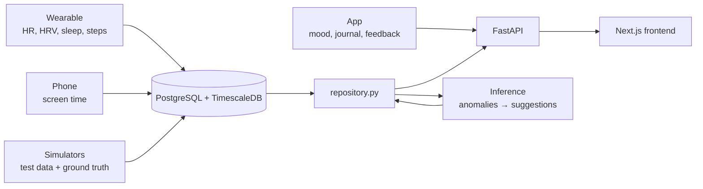

# Architecture

The backend keeps every signal in one database, works out what is unusual for each user, and serves the result to the frontend.



## Code layout

All backend code is the Python package `app` in [`backend/app`](../backend/app):

| Module | Role |
|---|---|
| `db/` | SQLAlchemy models, sessions, and `repository.py`: the only code that reads or writes tables |
| `api/` | FastAPI app, one router per resource; see [API](api.md) |
| `inference/` | [Anomaly detection](inference/anomalies.md) and [suggestions](inference/suggestions.md) |
| `simulators/` | One [simulator](simulators/README.md) per signal, plus shared timelines and sleep windows |

Migrations are in [`backend/alembic/versions`](../backend/alembic/versions) and the tests in [`backend/tests`](../backend/tests).

## Database

One **PostgreSQL + TimescaleDB** database holds all data: PostgreSQL 16 in Docker locally, [Neon](deployment.md#neon) when hosted. Time series and relational data live side by side, so inference can join heart rate, sleep, activity and mood in one query.

| Data | Shape | Table |
|---|---|---|
| Heart rate + HRV (RMSSD) | high-frequency samples | hypertable `heart_samples` |
| Steps, active minutes | per-minute/hour counts | hypertable `activity_samples` |
| Phone screen time | minutes per interval | hypertable `screen_samples` (from the phone, not the wearable) |
| Sleep | one session per night | `sleep_sessions` (stages in JSONB) |
| Mood check-in | one tap a day, score 1–5 | `mood_checkins` |
| Feeling journal | free text, Finnish or English | `journal_entries` |
| Inference + escalation | relational | `anomalies`, `suggestions`, `suggestion_feedback`, `contacts`, `consents`, `alerts` |

## Rules every part follows

- **Days are UTC calendar days.** A sleep session counts toward the day the user wakes up.
- **Daily metrics are computed on read.** `repository.daily_metrics` aggregates the hypertables per query, so freshly simulated, backfilled or deleted data shows up right away. Timescale continuous aggregates were tried and dropped in migration `0002`: they only refresh rows newer than the last refresh, so backfilled history stayed stale.
- **Every row has a `source`.** Samples default to `device`, check-ins and journal entries made in the app to `app`, and simulators write `simulator:<signal>:<scenario>`. That lets simulated data be told apart and cleared without touching real data.
- **Schema changes go through Alembic**, one numbered migration per change.

## Using the repository from Python

```python
from app.db import get_session
from app.db import repository as repo

with get_session() as s:  # commits on success, rolls back on error
    uid = repo.create_user(s, "demo")
    repo.insert_heart_samples(s, [{"user_id": uid, "ts": ts, "hr_bpm": 64, "hrv_rmssd_ms": 48, "source": "simulator:normal"}])
    repo.insert_sleep_session(s, uid, bedtime, wake_time, efficiency=0.9)
    repo.record_mood(s, uid, score=4)

    days = repo.daily_metrics(s, uid, start, end)             # one row per day, all metrics
    baseline = repo.rolling_baseline(s, uid, day, window=14)  # mean of the 14 days before `day`
```
